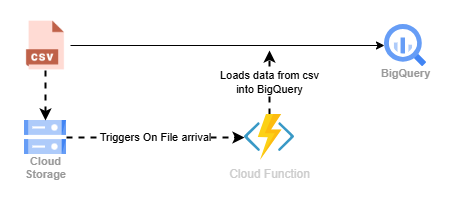
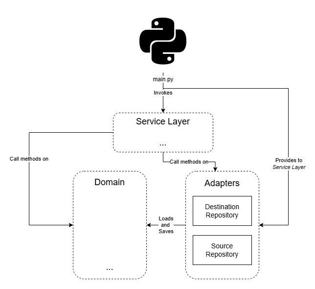
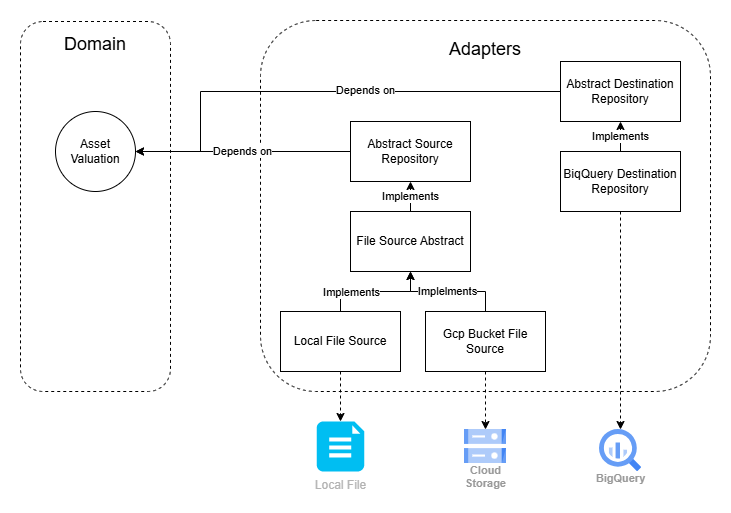

# Asset-valuation-ingestion
## Overview

This repository provides a solution for ingesting Asset Valuation data from files into a Data Warehouse (DW) layer. The current implementation supports parsing data from Generic and Hargreaves Lansdown file sources, whether stored locally or in a Google Cloud Platform (GCP) bucket. The ingested data is then stored in BigQuery. This repository includes tools, pipelines, and configurations designed to streamline the ingestion process while ensuring scalability and maintainability.

The solution is deployed using Terraform as a Google Cloud Function. This function is triggered whenever a file is uploaded to a specified GCP bucket. Upon activation, the function processes the CSV file and loads its data into BigQuery. See picture below.

|   |
|:----------------------------:|

## Features

- **Development Environment**: Pre-configured development container for consistent setup.
- **Comprehensive Testing**: Includes unit tests and integration tests to ensure code reliability, along with test coverage reporting.
- **Pipeline Integration**: Automated pipelines to unit test the Python solution and deploy it to GCP.


## Development Environment

### VS Code Dev Containers (Recommended)

The recommended development environment is the VS Code Dev Containers extension. The configuration and setup of this dev container is already defined in `.devcontainer/devcontainer.json`, so setting up a new containerized dev environment on your machine is straightforward.

Prerequisites:
- Docker installed on your machine and available on your `PATH`
- [Visual Studio Code](https://code.visualstudio.com/) (VS Code) installed on your machine
- [Dev Containers](https://marketplace.visualstudio.com/items?itemName=ms-vscode-remote.remote-containers) VS Code extension installed

Steps:
- In VS Code go to `View -> Command Palette` and search for the command `>Dev Containers: Rebuild and Reopen in Container`

The first time you open the workspace within the container, it will take a few minutes to build the container, set up the virtual environment, and then log in to gcloud. At the end of this process, you will be presented with a URL and asked to provide authorization. Simply follow the URL, permit access, copy the auth code provided at the end back into the terminal, and press Enter. 

### Configure Git 

For seamless Git usage in a Dev Container, create a local script at `.devcontainer/git_config.sh` (do not push this file to the repository) and set your GitHub account name and email:

```bash
#!/bin/bash

git config --global user.name "your github account name"
git config --global user.email "your github account email"
```

### Local Execution

The solution includes a Click-based CLI utility named `asset-valuation-ingestion`.

#### Configuration

You need to provide a `.env` file at the project root location with the following data:

```ini
PROJECT={name of GCP Project}
```

#### CLI Commands

You can run `asset-valuation-ingestion --help` to list available subcommands and options:

- **Load a local CSV file**:
  ```bash
  asset-valuation-ingestion load-local-file --file_path <FILE_PATH>
  # Short option:
  asset-valuation-ingestion load-local-file -fp <FILE_PATH>
  ```

- **Load a single file from a GCP Storage Bucket**:
  ```bash
  asset-valuation-ingestion load-gcp-file --bucket_name <BUCKET_NAME> --file_path <FILE_PATH>
  # Short options:
  asset-valuation-ingestion load-gcp-file -bn <BUCKET_NAME> -fp <FILE_PATH>
  ```

- **Load all files from a GCP Storage Bucket**:
  ```bash
  asset-valuation-ingestion load-all-files-from-bucket --bucket_name <BUCKET_NAME>
  # Short option:
  asset-valuation-ingestion load-all-files-from-bucket -bn <BUCKET_NAME>
  ```

### Unit Tests

To execute tests, provide a `tests/.env` file with the following data:

```ini
PROJECT={name of GCP Project}
SOURCE_BUCKET={If file is in GCP Bucket, name of bucket}
DESTINATION_TABLE={name of destination table in BQ}
DATASET={name of destination dataset in BQ}
```

Execute the following command in the terminal to run the tests:

```bash
python -m pytest -vv --cov --cov-report=html
```

Unit testing has been integrated into the CI/CD pipeline. A merge will not be approved unless all tests pass successfully. Additionally, a coverage report is automatically generated and provided as a comment for reference. A Service Account granted the `roles/bigquery.jobUser` role is required. The current workflow, `.github/workflows/pytest.yaml`, is configured to access the GCP project through a Workload Identity Provider.

## Supported Data Sources & File Formats

The ingestion engine detects the parser to use based on the file name prefix. All files must be in `.csv` format:

1. **Generic Source (`generic_*.csv`)**:
   - Files matching `generic_<date_or_tag>.csv` (e.g., `generic_2018_12_29.csv`).
   - Expected CSV header structure:
     ```csv
     product_name,date,value
     Global Index Fund,2023-01-01,1523.45
     ```
   - The date must follow the format `%Y-%m-%d`.

2. **Hargreaves Lansdown Source (`hl_*.csv`)**:
   - Files matching `hl_<date_or_tag>.csv` (e.g., `hl_2023_11_24.csv`).
   - Standard export report from Hargreaves Lansdown containing:
     - Header row with `Spreadsheet created at,DD-MM-YYYY ...` to extract valuation date.
     - `Total cash:` row for cash holdings.
     - Holdings table starting with column `Code` to parse individual asset values.

> [!NOTE]
> Files not matching `.csv` or missing the `generic_` / `hl_` naming prefix will raise `FileFormatError` or `FileTypeNotImplementedError`.

## BigQuery Destination Schema

Ingested valuations are stored in BigQuery in the destination table **`raw.asset_valuations_v2`** with the following schema:

| Column Name | Type | Description |
| :--- | :--- | :--- |
| `date` | `DATE` / `STRING` | Valuation date (`YYYY-MM-DD`). |
| `value` | `FLOAT` | Valuation numeric amount. |
| `product_name` | `STRING` | Name/code of the asset product. |
| `__source_file__` | `STRING` | Full path or URI of the ingested source file. |
| `__creation_date__` | `TIMESTAMP` / `STRING` | Ingestion timestamp (`YYYY-MM-DD HH:MM:SS`). |

## Component Diagram

The code architecture of the Python solution is illustrated below. We adopt Onion/Clean Architecture, ensuring that our Business Logic (Domain Model) has no external dependencies. Our goal is to follow SOLID principles, promoting seamless future changes and enhancing code clarity.

The `src/entrypoints/cloud_function/main.py` file is used by the deployed solution as the entry point, as required by GCP Cloud Functions. Locally, as described in the "Local Execution" section, code execution starts from the Python entry point located at `src/entrypoints/cli/__main__.py`. This entry point is invoked using the command `asset-valuation-ingestion` in a Bash terminal. 

Several entry points can be provided seamlessly because, following Clean Architecture principles, the entry point is treated as the last detail. This ensures that none of the core solution code depends on the entry point; instead, the entry point depends on the core solution code. This design promotes flexibility and allows for the easy addition of new entry points without impacting the existing architecture, which, in turn, means that the source code is independent of the infrastructure. 

The Python entry point invokes one of the services found in `src/services.py`. In this case, we have only the Asset Valuation pipeline. This service receives client instances for both the destination repository and the source repository as parameters.

The services handle the execution by calling methods found in the Domain and Adapters to ensure the successful completion of the process.

|  |
|:----------------------------:|

The clients for data storage have been implemented following the Repository pattern. This design pattern abstracts the logic for retrieving and storing data, providing a higher-level interface to the rest of the application. By doing so, it enables the implementation of the Dependency Inversion Principle (DIP). This approach allows our Database Layer (Adapters) to depend on the Domain Model, rather than the other way around. This, in turn, facilitates the seamless use of the same Business Logic/Domain Model in another scenario with a different Infrastructure/Data Layer.

Related code can be found in `src/destination_repository.py` and `src/source_repository.py`.

|  |
|:----------------------------:|

In the diagram above, you can also find the Domain Model diagram representing the code found in the `src/model.py` file. Circles represent value objects and rectangles represent entities.

## CI/CD - Pipeline Integration
There are 2 CI/CD pipelines implemented as GitHub Actions:

1. **Pytest**: This pipeline is defined in the `.github/workflows/pytest.yaml` file. It is triggered on every pull request, which runs unit tests using `pytest`. It also generates a test coverage report to ensure code quality. If any test fails, the pipeline will block the merge process, ensuring that only reliable code is integrated into the main branch. Finally, the pipeline requires test coverage above a given threshold. A Service Account granted the `roles/bigquery.jobUser` role is required. The current workflow, `.github/workflows/pytest.yaml`, is configured to access the GCP project through a Workload Identity Provider.

2. **Deployment**: The deployment process is managed through two GitHub Actions workflows. The first workflow, `.github/workflows/terraform-validate.yaml`, validates the Terraform code and generates a deployment plan during a pull request, blocking the merge in case of failure. The second workflow, `.github/workflows/terraform-apply.yaml`, executes after a merge to deploy the changes to Google Cloud Platform (GCP).

## Deployment Implementation

The Terraform code in this repository automates the deployment of the Asset Valuation ingestion solution on Google Cloud Platform (GCP). It provisions and configures the necessary resources to ensure seamless ingestion and processing of data. 

The Terraform code handles uploading the source code ZIP file to the designated Cloud Function source code bucket and creating the Cloud Function itself.

### Considerations

The Terraform code is designed to be executed by the workflows defined in `.github/workflows/terraform-validate.yaml` and `.github/workflows/terraform-apply.yaml`. These workflows first package the source code into a ZIP file, which is then used as the source code for the Cloud Function during Terraform execution.

If you prefer to execute the Terraform code locally, you must first run the `.github/package_cfsrc.sh`* Bash script to package the Cloud Function source code:

```bash
# Usage: .github/package_cfsrc.sh <RUNNER_TEMP_DIR> <OUTPUT_ZIP_FILE_PATH>
.github/package_cfsrc.sh /tmp /tmp/cf_source.zip
```

Once the ZIP file is created, you can proceed with running `terraform plan` or `terraform apply`, providing the path to the ZIP file:

```bash
cd terraform
terraform init
terraform plan -var="zip_file_path=/tmp/cf_source.zip"
terraform apply -var="zip_file_path=/tmp/cf_source.zip"
```

#### Terraform Variables

The following variables are defined in `terraform/variables.tf` (configured via `terraform.tfvars` or `-var` flags):

| Variable | Type | Default | Description |
| :--- | :--- | :--- | :--- |
| `project_id` | `string` | - | Name/ID of the Google Cloud project. |
| `region` | `string` | `"europe-west2"` | GCP location for deployed resources. |
| `cloud_function_name` | `string` | - | Name of the Cloud Function to create. |
| `service_account_name` | `string` | - | Service Account attached to the Cloud Function. |
| `function_entry_point` | `string` | - | Python entry point function (`func_entry_point`). |
| `zip_file_path` | `string` | - | Path to the ZIP archive containing Cloud Function code. |

A final consideration is that the backend for this solution is configured to reside in Google Cloud Storage (GCS). If you plan to reuse this code, ensure you update the backend bucket name accordingly in `terraform/main.tf`.

*\*This script must be executed from the repository root folder.*

### Prerequisites for Terraform Execution

Before the Terraform code can be executed, ensure the following:

1. **Default Cloud Storage Service Account**:
    - Assign the `roles/pubsub.publisher` role to your Default Cloud Storage Service Account.

2. **Cloud Function Service Account**:
    - Provide a Service Account for the Cloud Function with the following roles:
      - `roles/bigquery.dataEditor`
      - `roles/bigquery.jobUser`
      - `roles/run.invoker`
      - `roles/eventarc.eventReceiver`
      - `roles/storage.objectViewer` on the _raw assets_ bucket.

3. **Terraform Execution Permissions**:
    - Either your user account or the Service Account used to run the Terraform code must have the following roles:
      - `roles/iam.serviceAccountUser` on the Service Account mentioned in the previous point.
      - `roles/eventarc.admin`
      - `roles/cloudfunctions.admin`
      - `roles/storage.objectAdmin` on the _raw assets_, _source code_, and _backend_ buckets.
      - `roles/storage.insightsCollectorService`

To reuse the GitHub Actions workflows, follow these steps:

1. **Create a Workload Identity Provider (WIP):**  
   This enables keyless authentication for GitHub Actions.  
   - [Learn why this is needed](https://cloud.google.com/blog/products/identity-security/enabling-keyless-authentication-from-github-actions).  
   - [Follow these instructions](https://docs.github.com/en/actions/security-for-github-actions/security-hardening-your-deployments/configuring-openid-connect-in-google-cloud-platform).

2. **Set up the Service Account:**  
   - Grant the Terraform Executor Service Account the necessary permissions to execute Terraform code as indicated previously.
   - Assign the role `roles/iam.workloadIdentityUser`.
   - Set the Service Account as the principal for the Workload Identity Provider created in step 1.

3. **Provide Secrets:**
    - `WORKLOAD_IDENTITY_PROVIDER` and `SERVICE_ACCOUNT_EMAIL` must be provided as GitHub Actions secrets.